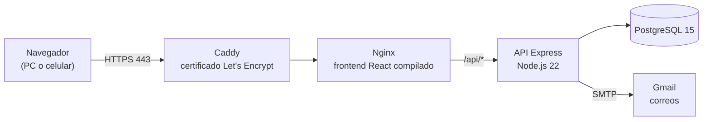
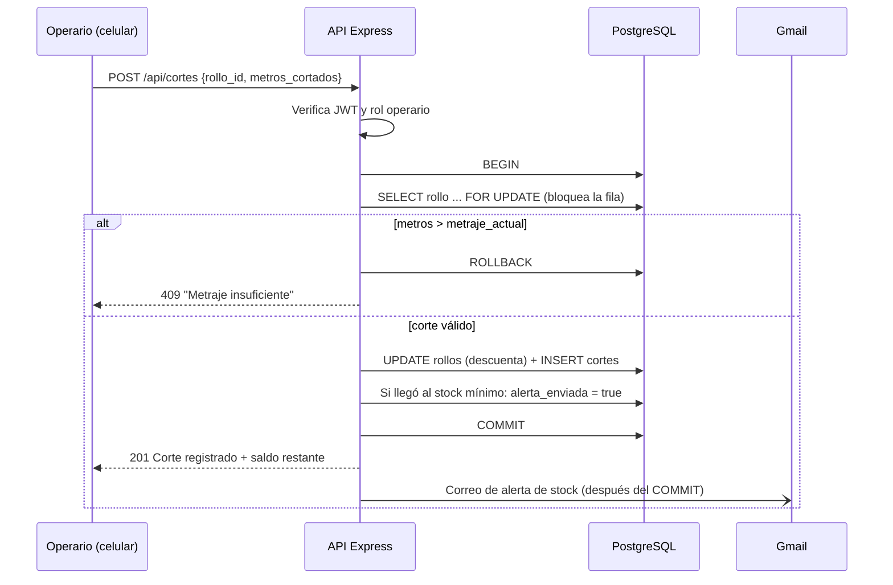
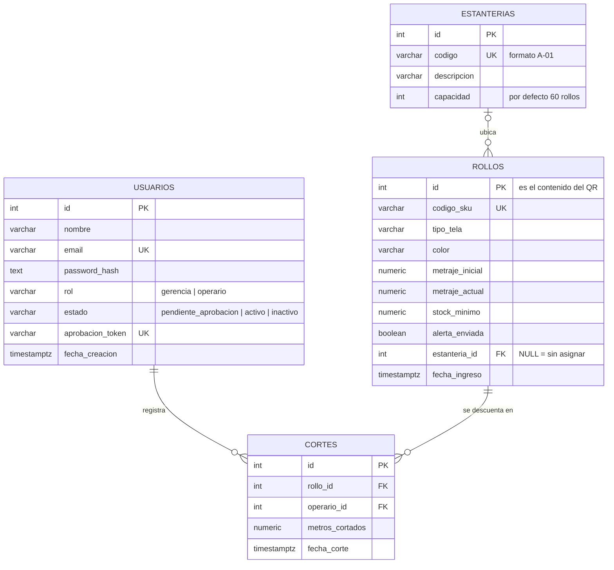

# Camisería Europea · Sistema de Inventario QR

**APP-INV-QR-CE-01** — Sistema de trazabilidad de inventario textil y soporte a la toma de decisiones (DSS) para Camisería Europea.
Cada rollo de tela tiene una etiqueta con código QR: el operario la escanea con el celular para registrar los cortes, y gerencia
controla el inventario, las ubicaciones en bodega, los usuarios y los reportes de consumo.

🌐 **Demo desplegada:** https://camiseria-europea.duckdns.org

Stack **PERN**: PostgreSQL · Express · React · Node.js — desplegado con Docker en AWS EC2.

---

## Contenido

1. [Funcionalidades](#1-funcionalidades)
2. [Arquitectura](#2-arquitectura)
3. [Tecnologías](#3-tecnologías)
4. [Estructura del proyecto](#4-estructura-del-proyecto)
5. [Backend: arquitectura por capas](#5-backend-arquitectura-por-capas)
6. [Base de datos](#6-base-de-datos)
7. [Reglas de negocio](#7-reglas-de-negocio)
8. [API REST](#8-api-rest)
9. [Frontend](#9-frontend)
10. [Variables de entorno](#10-variables-de-entorno)
11. [Ejecución en local (desarrollo)](#11-ejecución-en-local-desarrollo)
12. [Despliegue con Docker (AWS EC2)](#12-despliegue-con-docker-aws-ec2)
13. [Pruebas](#13-pruebas)
14. [Seguridad](#14-seguridad)

---

## 1. Funcionalidades

### Gerencia
- **Inventario:** registro de rollos (SKU, tela, color, metraje, stock mínimo y estantería) con generación de la **etiqueta QR** para imprimir.
- **Búsqueda con filtros acumulativos:** texto libre + color + tipo de tela + estantería + estado de stock, todos a la vez.
- **Estanterías:** ubicación física de cada rollo en bodega, con control de capacidad (no deja ubicar rollos en una estantería llena).
- **Reabastecimiento** de rollos y **cambio de ubicación**.
- **Usuarios:** creación de cuentas (nacen pendientes de aprobación), baja/reactivación y eliminación.
- **Historial de cortes** (auditoría) con el saldo que quedó después de cada corte.
- **Dashboard (DSS):** metros cortados, *Tela Estrella* (la de mayor consumo), *Tela Estancada* (con stock y sin rotación),
  gráficos por tela y por color, historial por día y **reporte en PDF**.

### Operario
- **Escaneo del QR** con la cámara del celular (o ingreso manual del ID del rollo).
- **Registro de cortes:** descuenta los metros del rollo; no permite cortar más de lo disponible.

### Automático
- **Aprobación dual:** ninguna cuenta entra hasta que el Súper Administrador la aprueba desde el enlace que recibe por correo.
- **Alerta de stock crítico** por correo cuando un rollo llega a su stock mínimo.
- Actualización de los datos en pantalla en "tiempo real" (consulta periódica cada 5–30 s).

---

## 2. Arquitectura



- La página y la API se sirven desde **el mismo dominio**: Nginx entrega la aplicación React y reenvía todo lo que empieza por
  `/api` al backend. Así el navegador no necesita CORS y el backend nunca queda expuesto directamente a internet.
- En desarrollo, el mismo papel de Nginx lo cumple el **proxy de Vite** (`frontend/vite.config.js`).
- Los cuatro servicios corren como contenedores con **Docker Compose** (`docker-compose.yml`).

---

## 3. Tecnologías

| Capa | Tecnologías |
|---|---|
| Frontend | React 19, Vite 8, React Router 7, Axios, Recharts (gráficos), html5-qrcode (escáner), jsPDF + autotable (PDF), lucide-react (íconos) |
| Backend | Node.js 22, Express 5, JSON Web Tokens, bcryptjs, nodemailer, qrcode, pg (driver de PostgreSQL) |
| Base de datos | PostgreSQL 15 |
| Infraestructura | Docker y Docker Compose, Nginx, Caddy (HTTPS automático), AWS EC2 (Ubuntu), DuckDNS |
| Pruebas | node:test, Postman / Newman, Playwright |

---

## 4. Estructura del proyecto

```
pagina-camiseria-europea/
├── Backend/                      API REST (Express)
│   ├── src/
│   │   ├── server.js             Punto de entrada: verifica la BD y levanta el servidor
│   │   ├── app.js                Configura Express: CORS, JSON, rutas y manejo de errores
│   │   ├── config/               env.js (variables), db.js (pool y transacciones),
│   │   │                         permisos.js (matriz de roles), constants.js
│   │   ├── routes/               Define las URL y los permisos de cada endpoint
│   │   ├── controllers/          Recibe la petición HTTP y devuelve la respuesta
│   │   ├── services/             Lógica de negocio (validaciones, reglas, correos, QR)
│   │   ├── repositories/         Consultas SQL parametrizadas a PostgreSQL
│   │   ├── middlewares/          auth (JWT + roles) y manejo centralizado de errores
│   │   └── utils/                Validaciones, catálogo de colores, errores, formatos
│   ├── database/
│   │   ├── init.sql              Esquema completo + datos iniciales
│   │   ├── migrations/           Cambios de esquema para bases ya existentes
│   │   └── rollbacks/            Reversión de las migraciones
│   ├── scripts/                  initDb, migrate y datos de demostración
│   ├── tests/                    Pruebas de API automatizadas (npm test)
│   ├── Dockerfile
│   └── .env.example              Variables para desarrollo local
├── frontend/                     Aplicación web (React + Vite)
│   ├── src/
│   │   ├── main.jsx · App.jsx    Arranque y rutas (/login, /gerencia, /operario)
│   │   ├── api/                  Llamadas a la API (un archivo por recurso)
│   │   ├── context/ · hooks/     Sesión (AuthProvider, useAuth), usePolling, useDebounce
│   │   ├── components/           Navbar, Modal, Alerta, EscanerQR, EtiquetaQR, ProtectedRoute…
│   │   ├── pages/                Login, gerencia/ (pestañas y ventanas), operario/
│   │   ├── utils/                Formatos, estados de stock, reporte PDF
│   │   └── styles/index.css
│   ├── Dockerfile · nginx.conf   Compilación y servidor de producción
│   └── vite.config.js            Servidor de desarrollo y proxy /api
├── pruebas/                      Colección de Postman y pruebas funcionales
├── docker-compose.yml            db + backend + frontend (+ https opcional)
├── Caddyfile                     HTTPS automático
├── .env.example                  Variables para el despliegue con Docker
└── claude.md                     Requisitos y reglas de negocio del sistema
```

---

## 5. Backend: arquitectura por capas

Cada petición atraviesa siempre las mismas capas, y cada una tiene una sola responsabilidad:

```
Ruta  →  Middleware (JWT + permiso)  →  Controlador  →  Servicio  →  Repositorio  →  PostgreSQL
```

| Capa | Responsabilidad | Ejemplo |
|---|---|---|
| **Rutas** (`routes/`) | URL, método HTTP y permiso requerido | `POST /api/cortes` exige el permiso `cortes:registrar` |
| **Middlewares** | Verificar el token y el rol; traducir errores a respuestas HTTP | `autenticar`, `autorizar('cortes:registrar')` |
| **Controladores** (`controllers/`) | Leer la petición y enviar la respuesta. Sin lógica de negocio | `corteController.registrar` |
| **Servicios** (`services/`) | Validar datos y aplicar las reglas de negocio | "no cortar más de lo disponible", alertas de stock |
| **Repositorios** (`repositories/`) | SQL **parametrizado** (`$1, $2…`), nunca concatenado | `UPDATE rollos SET metraje_actual = …` |

### Ejemplo: registrar un corte



El bloqueo `FOR UPDATE` hace que dos cortes simultáneos sobre el mismo rollo se ejecuten uno detrás del otro, así el saldo
nunca queda negativo. El correo se envía después del `COMMIT`: si el SMTP falla, el corte ya quedó registrado y la alerta
se reintenta en el siguiente corte.

### Control de acceso por roles (RBAC)

La matriz completa está en `Backend/src/config/permisos.js` (única fuente de verdad):

| Permiso | Gerencia | Operario |
|---|:---:|:---:|
| Gestionar usuarios | ✅ | ❌ |
| Ver inventario completo, registrar y reabastecer rollos | ✅ | ❌ |
| Generar etiquetas QR y reubicar rollos | ✅ | ❌ |
| Consultar la ficha de un rollo (lectura del QR) | ✅ | ✅ |
| Consultar estanterías | ✅ | ✅ |
| Crear estanterías | ✅ | ❌ |
| **Registrar cortes** | ❌ | ✅ |
| Historial de cortes, dashboard y reportes | ✅ | ❌ |

---

## 6. Base de datos



- **`database/init.sql`** crea todo el esquema, las estanterías de ejemplo y la cuenta inicial de gerencia
  (`gerente@camiseriaeuropea.com`, cuya contraseña inicial está comentada en ese archivo: **cámbiala tras el primer ingreso**).
  Con Docker se ejecuta solo, la primera vez que se crea el volumen de la base de datos.
- **`database/migrations/`** aplica cambios a bases que ya existían (`npm run db:migrate`). Son idempotentes.
- Las restricciones de la base son la última barrera de las reglas de negocio: `CHECK (metraje_actual >= 0 AND
  metraje_actual <= metraje_inicial)`, claves foráneas con `ON DELETE RESTRICT` (el historial de cortes nunca se pierde), etc.

---

## 7. Reglas de negocio

| Regla | Dónde se implementa |
|---|---|
| Ningún usuario se auto-registra: gerencia crea la cuenta y nace `pendiente_aprobacion` | `usuario.service.js` |
| El acceso se habilita solo con el enlace que recibe por correo el Súper Administrador (un solo uso) | `usuario.service.js`, `email.service.js` |
| Un corte nunca supera el `metraje_actual` del rollo | `corte.service.js` + `CHECK` en la BD |
| Descontar tela, registrar el corte y evaluar la alerta ocurren en **una sola transacción** (`BEGIN`/`COMMIT`/`ROLLBACK`) | `corte.service.js`, `config/db.js` (`withTransaction`) |
| Si el saldo llega al stock mínimo se envía **una** alerta por correo y se marca `alerta_enviada` | `corte.service.js`; al reabastecer se vuelve a armar |
| El color debe pertenecer al catálogo de colores textiles; se rechazan números y caracteres especiales | `utils/colores.js` |
| Los filtros del inventario se combinan (texto + color + tela + estantería) | `rollo.repository.js` |
| Una estantería no puede superar su capacidad | `estanteria.service.js` (con bloqueo de fila) |
| La cuenta del Gerente General no se puede dar de baja ni eliminar; nadie puede eliminarse a sí mismo | `usuario.service.js` |
| Un usuario con cortes no se borra: se desactiva y su correo queda libre (se conserva el historial) | `usuario.service.js` |

---

## 8. API REST

Todas las rutas empiezan por `/api`. Las protegidas necesitan la cabecera `Authorization: Bearer <token>`.
Las respuestas de error tienen la forma `{ "error": "mensaje" }`.

| Método | Endpoint | Rol | Descripción |
|---|---|---|---|
| GET | `/health` | Público | Estado de la API |
| POST | `/auth/login` | Público | Inicia sesión y devuelve el token JWT |
| GET | `/auth/me` | Autenticado | Usuario de la sesión actual |
| GET | `/usuarios` | Gerencia | Lista de usuarios |
| POST | `/usuarios` | Gerencia | Crea un usuario (pendiente de aprobación) y le envía sus credenciales |
| PATCH | `/usuarios/:id/estado` | Gerencia | Da de baja o reactiva (`activo` / `inactivo`) |
| DELETE | `/usuarios/:id` | Gerencia | Elimina (o desactiva si tiene cortes) |
| GET | `/usuarios/aprobar/:token` | Enlace del correo | Aprueba la cuenta (responde una página HTML) |
| GET | `/rollos` | Gerencia | Inventario. Filtros: `search`, `buscar_por`, `color`, `tipo_tela`, `estanteria_id` |
| GET | `/rollos/resumen` | Gerencia | Metros disponibles por tela y color |
| GET | `/rollos/filtros` | Gerencia | Opciones de los filtros |
| GET | `/rollos/catalogo-colores` | Gerencia | Colores válidos |
| POST | `/rollos` | Gerencia | Registra un rollo y devuelve su QR |
| PATCH | `/rollos/:id/reabastecer` | Gerencia | Suma metros al rollo |
| PATCH | `/rollos/:id/ubicacion` | Gerencia | Cambia la estantería (`null` = sin asignar) |
| GET | `/rollos/:id/etiqueta` | Gerencia | Etiqueta QR del rollo |
| GET | `/rollos/:id` | Gerencia y operario | Ficha del rollo (lectura del QR) |
| GET | `/estanterias` | Gerencia y operario | Estanterías con ocupación y lugares libres |
| POST | `/estanterias` | Gerencia | Crea una estantería |
| POST | `/cortes` | Operario | Registra un corte |
| GET | `/auditoria/cortes` | Gerencia | Historial de cortes (`?fecha=AAAA-MM-DD` para un día) |
| GET | `/reportes/consumo` | Gerencia | Reporte de consumo (`?rango=diario\|semanal\|quincenal\|mensual`) |

Ejemplo:

```bash
curl -X POST https://camiseria-europea.duckdns.org/api/auth/login -H "Content-Type: application/json" -d '{"email":"usuario@correo.com","password":"********"}'
```

---

## 9. Frontend

- **Rutas** (`App.jsx`): `/login`, `/gerencia` (solo gerencia) y `/operario` (solo operario). `ProtectedRoute` redirige
  según el permiso de la sesión.
- **Panel de gerencia** (`pages/gerencia/Gerencia.jsx`): pestañas *Inventario*, *Usuarios*, *Historial de cortes* y
  *Dashboard y Reportes*; las acciones abren ventanas modales (nuevo rollo, reabastecer, ubicación, nuevo usuario, eliminar).
- **Panel del operario** (`pages/operario/Operario.jsx`): escáner QR → ficha del rollo → registro del corte.
- **Comunicación con la API** (`api/client.js`): cliente Axios con `baseURL = '/api'` (o `VITE_API_URL` si se define). Añade el
  token en cada petición y, si la API responde 401, cierra la sesión.
- **Sesión:** el token se guarda en `sessionStorage` (una sesión por pestaña), así dos personas pueden usar pestañas distintas
  sin mezclar sus cuentas.
- **Tiempo real:** `hooks/usePolling.js` vuelve a consultar los datos cada pocos segundos y se pausa si la pestaña está oculta.
- **Cámara:** los navegadores solo permiten la cámara en **HTTPS** (o `localhost`). Por eso el servidor de desarrollo usa un
  certificado propio y la versión publicada usa Caddy.

---

## 10. Variables de entorno

Nunca subas los archivos `.env` a git (ya están en `.gitignore`). Usa las plantillas `.env.example`.

### Desarrollo local — `Backend/.env`

| Variable | Descripción |
|---|---|
| `PORT` | Puerto de la API (3000) |
| `CORS_ORIGIN` | Origen permitido del frontend |
| `JWT_SECRET` | Clave para firmar los tokens (obligatoria) |
| `JWT_EXPIRES_IN` | Duración de la sesión (8h) |
| `DB_HOST`, `DB_PORT`, `DB_USER`, `DB_PASSWORD`, `DB_NAME` | Conexión a PostgreSQL |
| `API_URL`, `FRONTEND_URL` | URL públicas que se usan en los enlaces de los correos |
| `SMTP_HOST`, `SMTP_PORT`, `SMTP_USER`, `SMTP_PASS` | Correo de Gmail (`SMTP_PASS` es una *contraseña de aplicación*) |
| `SUPER_ADMIN_EMAIL` | Recibe los enlaces de aprobación de cuentas |
| `ALERTAS_STOCK_EMAIL` | Recibe las alertas de stock (si está vacío, se usa `SUPER_ADMIN_EMAIL`) |

### Despliegue con Docker — `.env` en la raíz

| Variable | Descripción |
|---|---|
| `PUBLIC_URL` | URL pública, p. ej. `https://camiseria-europea.duckdns.org` (enlaces de los correos y CORS) |
| `HTTP_PORT` | Puerto del frontend (`80`, o `127.0.0.1:8080` cuando se usa HTTPS) |
| `COMPOSE_PROFILES`, `DOMAIN` | Activan el HTTPS con Caddy (`https` y el dominio) |
| `DB_USER`, `DB_PASSWORD`, `DB_NAME` | Credenciales de la base de datos del contenedor |
| `JWT_SECRET`, `JWT_EXPIRES_IN` | Igual que en desarrollo |
| `SMTP_*`, `SUPER_ADMIN_EMAIL`, `ALERTAS_STOCK_EMAIL` | Igual que en desarrollo |

Generar una clave segura: `openssl rand -hex 48`

---

## 11. Ejecución en local (desarrollo)

Requisitos: **Node.js 22**, **Docker Desktop** y Git.

Base de datos (PostgreSQL en Docker). **La primera vez** crea el contenedor: copia `.env.example` como `.env` en la raíz y
completa `DB_PASSWORD` (la misma contraseña que usarás en `Backend/.env`), `JWT_SECRET` y `PUBLIC_URL=http://localhost`.
Docker Compose los pide aunque solo se levante la base de datos. Luego ejecuta:

```bash
docker compose up -d db
```

Las veces siguientes basta con encenderlo:

```bash
docker start camiseria_postgres
```

Backend:

```bash
cd Backend
```
```bash
npm install
```
```bash
cp .env.example .env
```
Completa el `.env` (al menos `JWT_SECRET`) y arranca la API en `http://localhost:3000/api`:
```bash
npm run dev
```

Frontend (en otra terminal):

```bash
cd frontend
```
```bash
npm install
```
```bash
npm run dev
```

Abre `https://localhost:5173`. El certificado es propio, así que acepta la advertencia del navegador; es necesario para la
cámara. Para usar HTTP normal: `npm run dev:http`.

**Desde el celular en la misma red Wi-Fi:** abre `https://<IP-del-PC>:5173`. Vite escucha en todas las interfaces y reenvía
`/api` al backend.

---

## 12. Despliegue con Docker (AWS EC2)

`docker-compose.yml` levanta todo el sistema:

| Servicio | Imagen | Función |
|---|---|---|
| `db` | postgres:15 | Base de datos (solo accesible desde la propia máquina) |
| `backend` | `Backend/Dockerfile` | API Express |
| `frontend` | `frontend/Dockerfile` | Compila React y lo sirve con Nginx; reenvía `/api` al backend |
| `https` *(opcional)* | caddy:2 | HTTPS con certificado gratuito de Let's Encrypt |

En el servidor (Ubuntu con Docker instalado):

```bash
git clone -b feature/docker-despliegue https://github.com/davidavilez/pagina-camiseria-europea.git && cd pagina-camiseria-europea
```
```bash
cp .env.example .env && nano .env
```
```bash
docker compose up -d --build
```
```bash
docker compose ps
```

Grupo de seguridad de EC2: puertos **22** (SSH), **80** (HTTP) y **443** (HTTPS). Nunca abras el 5432.

**Actualizar después de un cambio** (primero se hace `git push` desde el PC):

```bash
cd ~/pagina-camiseria-europea && git pull && docker compose up -d --build
```

Otros comandos útiles:

| Comando | Para qué |
|---|---|
| `docker compose logs backend --tail 50` | Ver errores de la API |
| `docker compose logs https --tail 20` | Ver el estado del certificado HTTPS |
| `docker compose exec backend npm run db:migrate` | Aplicar migraciones nuevas |
| `docker compose exec -T db pg_dump -U admin -d inventario_telas > respaldo.sql` | Respaldo de la base de datos |

---

## 13. Pruebas

| Tipo | Ubicación | Casos | Ejecución |
|---|---|---|---|
| API automatizadas | `Backend/tests/` | 121 | `cd Backend` y luego `npm test` |
| API con Postman | `pruebas/postman/` | 50 peticiones · 85 validaciones | Postman → *Run collection* |
| Funcionales (interfaz) | `pruebas/funcionales/` | 37 | Playwright |

Las pruebas de API usan **su propia base de datos** (`inventario_telas_test`), que se crea y se borra sola: nunca tocan los
datos reales. Detalles en [`pruebas/README.md`](pruebas/README.md).

---

## 14. Seguridad

- Contraseñas con **bcrypt** y sesiones con **JWT** que vencen. Cada petición verifica que la cuenta siga activa.
- **Consultas SQL parametrizadas** en todos los repositorios (protección contra inyección SQL).
- Permisos verificados **en el backend** en cada endpoint, no solo ocultando botones en la interfaz.
- Los mensajes de error nunca exponen detalles internos; el login no revela si un correo existe.
- Los enlaces de aprobación son de un solo uso, y los correos de aprobación tienen un límite de reenvío (15 minutos).
- PostgreSQL no se expone a internet; la API solo se alcanza a través de Nginx.
- Pendiente de revertir: CORS abierto (`origin: '*'`) y `allowedHosts: true` en Vite, que se dejaron temporalmente para la
  presentación remota (están marcados con `TEMPORAL` en el código).
